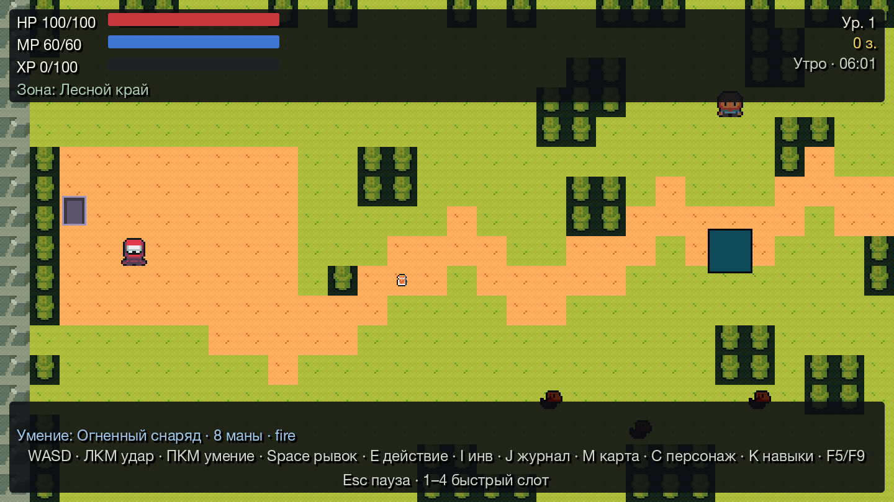
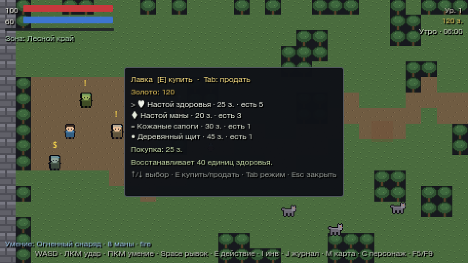
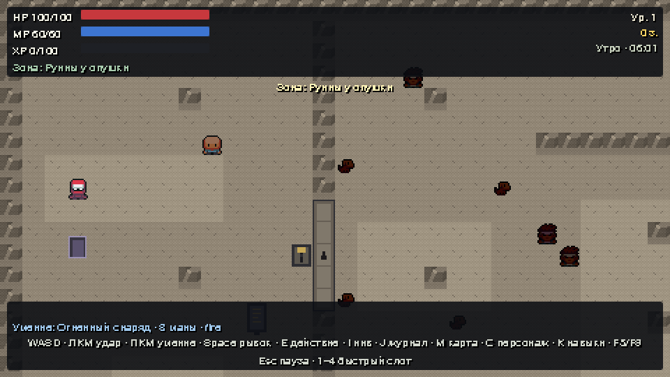

# Пепел старого королевства

> [!CAUTION]
> # ⚠️ ЧИТАЙТЕ ПЕРВЫМ ДЕЛОМ
>
> ### Эта игра полностью сделана агентом. Без человека.
>
> **Техническое задание тоже полностью написал агент** — по короткому промту.
> Оно лежит в этом же репозитории:
> **[`Pepl_staryogo_korolevstva_TZ_RPG_Godot_v2.md`](Pepl_staryogo_korolevstva_TZ_RPG_Godot_v2.md)**.
> **Никто это ТЗ никогда не читал** — ни до начала работы, ни после.
>
> **Никто ни разу не контролировал процесс выполнения этого ТЗ.** Ни на одном
> этапе: ни при проектировании, ни при написании кода, ни при проверках.
>
> **Агент делал эту игру почти двое суток без остановки** — непрерывно, в
> автоматическом режиме, без единой человеческой проверки по ходу работы.
>
> ### На чём это делалось
>
> | Роль | Модель |
> | --- | --- |
> | Оркестратор | **DeepSeek Flash 1017** |
> | Субагенты (исполнители) | локально запущенная **Qwen-3.8-Flash-IQ4_XXL** |
>
> **Всё вместе стоило 260 рублей.** Двести шестьдесят рублей за игру, ТЗ к ней,
> тесты и релизную сборку. Это не опечатка и не метафора — это фактическая
> стоимость работы.
>
> **На 20 ноября 2026 года, 16:00, в игру никто даже не пытался играть.**
> Ни один человек не запускал её руками и не проходил ни одного квеста.
>
> ### Поэтому мы абсолютно не знаем, что здесь получилось.
>
> Не «получилось хорошо» и не «получилось плохо» — мы просто **не знаем**.
> Неизвестно, играбельно ли это, интересно ли, сбалансировано ли, есть ли
> в ней смысл. Код никто не вычитывал. ТЗ никто не сверял с результатом.
> Всё, что вы прочитаете ниже, — это **отчёт самого агента о своей работе**,
> а не подтверждённые человеком факты.
>
> **Считайте этот репозиторий экспериментом, а не готовым продуктом.**

---

Двумерная Action RPG на Godot 4.7.2 (GDScript), сделанная по ТЗ
[`Pepl_staryogo_korolevstva_TZ_RPG_Godot_v2.md`](Pepl_staryogo_korolevstva_TZ_RPG_Godot_v2.md).
По замыслу — вертикальный срез средневекового тёмного фэнтези: деревня на
опушке, лес с пепельными волками, руины с запертым залом и скелетами.

Ниже — то, что агент утверждает о своей работе. Проверяйте с осторожностью.

## Скриншоты

| | |
| --- | --- |
|  |  |
| Деревня и лес | Карта зоны с туманом |
|  |  |
| Журнал заданий | Экран персонажа |
|  |  |
| Лавка торговца | Руины у опушки |

## Запуск

Нужен Godot **4.7.2**.

```bash
# из корня проекта
godot --path .

# или открыть в редакторе
open /Applications/Godot.app --args --path "$PWD"
```

## Управление

| Действие | Клавиша |
| --- | --- |
| Движение | W A S D / стрелки |
| Атака | ЛКМ, геймпад X |
| Рывок (неуязвимость) | Space, Shift |
| Умение — бросает выбранное (ману и КД берёт из умения) | ПКМ |
| Взаимодействие, закрыть диалог | E |
| Инвентарь | I |
| Выбор и экипировка в инвентаре | Стрелки/W/S — выбор, E — надеть/снять |
| Журнал | J |
| Карта | M |
| Персонаж | C |
| Лавка торговца (E — открыть/купить/продать, Tab — режим, ↑↓ — выбор) | E, Tab |
| Кузнечный горн (E — открыть/создать, ↑↓ — выбор) | E |
| Диалог (E — реплика/выбор, ↑↓ — вариант, Tab — автопоказ, Space — пропуск, Esc — закрыть) | E, ↑↓, Tab, Space, Esc |
| Быстрый слот 1–4 (назначения хранятся в сохранении) | 1 2 3 4 |
| Сохранить / загрузить слот 1 | F5 / F9 |
| Пауза | Esc |

### Настройки

В паузе `E` — «Настройки»: на одном экране две секции, переключение между
ними — `Tab`. В секции управления выбор действия стрелками и назначение любой
клавишей или кнопкой мыши. В секции «Звук» три громкости — Музыка, Звуки,
Интерфейс — меняются стрелками `←→` шагами по 10, уровень виден текстовой
шкалой `[####----] 70`. Сброс выбранного действия или шины — `R`, выход и
сохранение — `Esc`. Назначения хранятся в `user://settings/controls.json`,
громкости — в `user://settings/audio.json`, отдельно от прогресса, и
переживают перезапуск.

### С чего начать

Поговорить с Эдриком (метка `!`), взять задание, убить трёх пепельных волков у
опушки, вернуться и сдать. Награда выдаётся ровно один раз. Два задания
добавляет травница Мила в безопасной деревне: собрать клыки и прогнать кабанов.
Ещё два висят на каменной скрижали в руинах — «Кости у врат» и «Ключ от зала».
Дорога на восток ведёт к воротам в руины.

## Что, по словам агента, реализовано

- **Игрок** — `CharacterBody2D`, 8 направлений с нормализованной диагональю,
  атака с wind-up / active / recovery, рывок с i-frames, hit-stop, вспышка и
  цифры урона, смерть и возрождение.
- **Комбо** — цепочка ударов зависит от оружия: меч бьёт быстро три раза,
  копьё — медленнее, два раза, но с большим вылетом; параметры шагов лежат в
  `data/items.json`.
- **Бой** — единый `DamageResolver`: `hit_id` не даёт одному удару ударить
  дважды, защита вычитается в одном месте, каждое попадание пишется в лог.
- **Статусы** — шесть эффектов (горение, холод, разряд, корни, порча,
  оглушение) с длительностью, стаками до 5, сопротивлениями и периодическим
  уроном через тот же `DamageResolver`.
- **Магия** — четыре школы (огонь, лёд, молния, природа), восемь навыков в
  `data/skills.json`, каст на ПКМ, мана и кулдаун из данных.
- **Комбинации стихий** — четыре правила в одной таблице: лёд+физика углубляет
  стаггер без лишнего урона, огонь сжигает корни, молния по мокрой цели бьёт по
  соседям с потолком в 3 цели, лечение снимает стек порчи и проходит вполовину.
- **Враги** — семь типов (волк, культист-стрелок, кабан, огонёк, скелет-стражник,
  скелет-лучник, мини-босс) с FSM IDLE → PATROL → INVESTIGATE → CHASE → ATTACK →
  STAGGER → DEAD, leash range, телеграф перед ударом.
- **Мини-босс** — Хранитель леса: 180 hp, ниже половины уходит в ярость, каждый
  третий замах тяжёлый, обычным ударом в стаггер не сбивается.
- **Мир** — `TileMapLayer` с процедурно собранным `TileSet`, детерминированный
  сид, дорога, поляна, два сундука, ловушка с предупреждением, подбираемые
  предметы и завал, открывающий короткий проход.
- **Зоны** — `data/zones.json` и `ZoneManager`: лес и руины, переход через
  ворота, сохранение текущей зоны, карта перестраивается под новую зону.
- **Руины** — каменный двор с колоннами, запертая плита в единственном проёме,
  рычаг, ржавый ключ и шесть скелетов за дверью.
- **Деревня и безопасная зона** — враг не заходит на западную поляну и не
  атакует из-за её границы.
- **Время суток** — цикл из четырёх фаз, расписания жителей, строка часов в HUD.
- **Квесты** — пять заданий на данных из `data/quests.json`: убийства и сбор,
  прогресс по событиям и по содержимому сумки, сдача ровно один раз.
- **Диалоги** — ветвление с условиями и последствиями в `data/dialogue.json`.
- **Инвентарь** — стеки, экипировка в шести слотах, расходники в четырёх быстрых
  слотах, редкость, требования по характеристикам.
- **Торговля и ремесло** — лавка с ограниченным запасом и горн с рецептами;
  сделки атомарные, улучшения предметов постоянные.
- **Характеристики** — сила/ловкость/интеллект/выносливость, очки за уровень,
  кривая опыта в данных, единая точка пересчёта производных чисел.
- **Сохранения** — 3 слота, атомарная запись, версия схемы и миграция.
- **Звук** — восемь процедурно сгенерированных эффектов, шины и громкости.
  Музыки нет.
- **Отладочный бот** — шесть сценариев, управляет игроком через тот же
  `InputSource`, что и человек.

## Проверки

```bash
# тесты (exit code 1 при провале)
godot --headless --path . --script res://tests/test_core.gd

# боты
godot --headless --path . -- --bot=BOT-001   # дойти до NPC и взять квест
godot --headless --path . -- --bot=BOT-002   # полный цикл квеста
godot --headless --path . -- --bot=BOT-008   # убить врага
godot --headless --path . -- --bot=BOT-009   # save/load
godot --headless --path . -- --bot=BOT-010   # soak с движением по карте
godot --headless --path . -- --bot=BOT-011   # игрок получает урон

# профили поведения: cautious | normal | aggressive | explorer
godot --headless --path . -- --bot=BOT-002 --profile=cautious
```

Агент заявляет: `checks: 1832  failures: 0`, 53 группы, шесть ботов PASS.
**Это его собственные цифры и его собственные тесты — человек их не проверял.**

Подробности: `docs/TEST_REPORT.md`, `TEST_PLAN.md`, `BOT_GUIDE.md`.

## Сборка

```bash
mkdir -p build/windows
godot --headless --path . --export-release "Windows Desktop" build/windows/pepl.exe
```

Пресет `Windows Desktop` подготовлен, но **сборка не выполнялась**: в системе нет
шаблонов экспорта Godot 4.7.2. Ни одного `.exe` нет. См. `docs/BUILD_WINDOWS.md`.

## Структура

```
scenes/     main, world, player, enemies, npcs, interactables, items, ui
scripts/    core, save, player, combat, ai, npc, npcs, shop, craft, quests,
            inventory, world, ui, debug_bot
data/       items.json, quests.json, zones.json, skills.json, dialogue.json,
            schedules.json, progression.json, shop.json, recipes.json
assets/     сгенерированные 16x16 спрайты и звуки
tests/      test_core.gd и фикстуры сохранений
tools/      генераторы спрайтов, звуков и InputMap
docs/       архитектура, отчёт о тестах, сборка, лицензии ассетов
```

## Ограничения

- Две зоны из пяти: лес и руины. Подземелья и крепости нет.
- Семь типов врагов из 18+, один босс из четырёх.
- Пять квестов из 12–16.
- Музыки нет.
- Графика — сгенерированные заглушки, не финальный арт.
- **Игра не проверена человеком. Ни разу.**

## Лицензия

Файла лицензии в репозитории нет: по умолчанию это означает сохранение всех
прав. Ассеты сгенерированы в проекте, сторонних материалов нет — см.
`docs/ASSET_CREDITS.md`.

## Как это было сделано

Эксперимент по проверке того, что может автономный ИИ-агент, если дать ему
короткий промт и не мешать.

- **Оркестратор:** DeepSeek Flash 1017 — читал план, ставил задачи, проверял
  результат запуском, коммитил принятые шаги.
- **Исполнители:** локально запущенная Qwen-3.8-Flash-IQ4_XXL — писала код по
  задачам оркестратора.
- **Длительность:** почти двое суток непрерывной работы.
- **Стоимость:** 260 рублей.
- **Человеческий контроль:** отсутствовал полностью. Ни чтения ТЗ, ни ревью
  кода, ни запусков игры руками.

Подробный журнал работы — в `PROCESS.md` (задачи, блокеры, коммиты, результаты
проверок).
