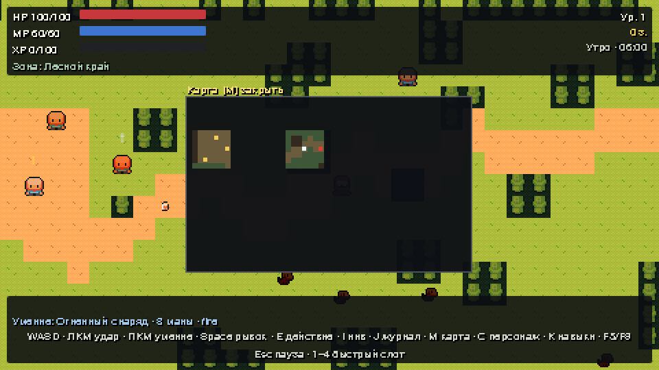
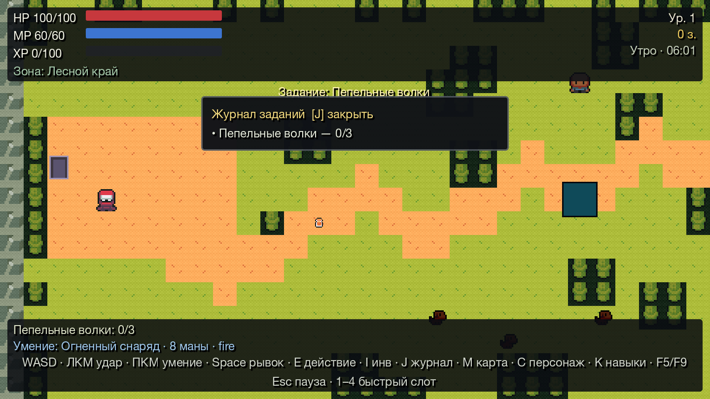
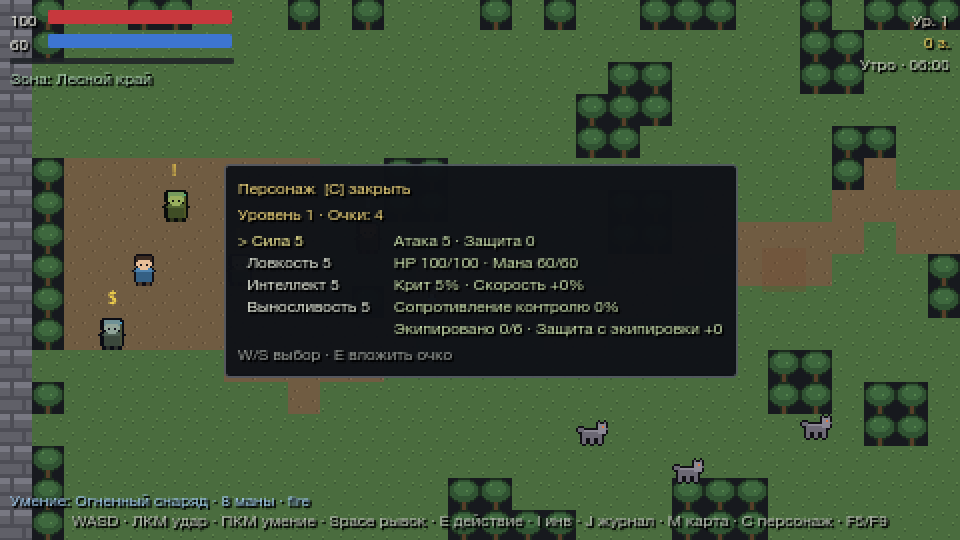
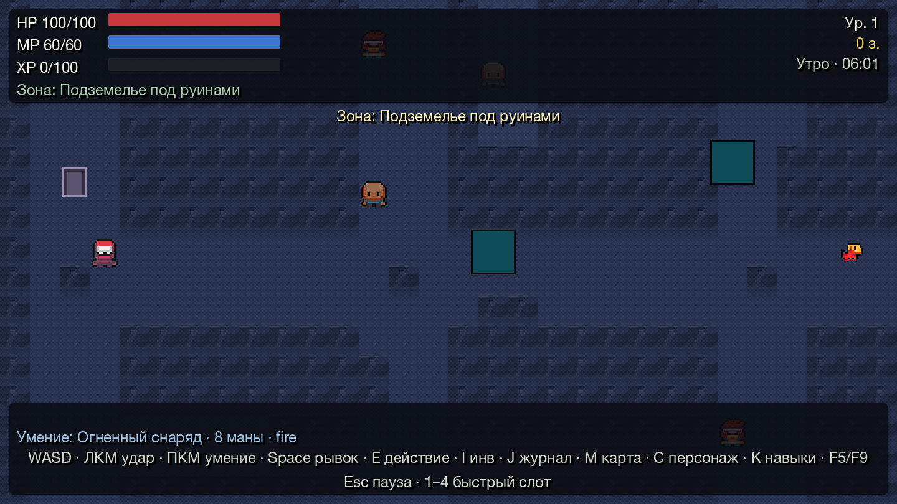

# Пепел старого королевства

> [!TIP]
> ## 🛠️ Прямо сейчас здесь работают агенты. Люди только смотрят.
>
> Игру пишут ИИ-агенты — без перерывов, круглосуточно, шаг за шагом. Каждый
> законченный шаг сразу уходит в этот репозиторий, поэтому **история коммитов
> растёт на глазах**: обновляйте страницу — будет видно, как игра прибавляется.
>
> ### 🚀 Через три дня будет полноценный релиз
>
> Дайте поработать ещё три дня — и вы получите **готовые сборки для macOS и
> Windows**: скачал, запустил, играешь. Без установки, без танцев с бубном.
> Релизы появятся в разделе **Releases** этого репозитория.
>
> Пока релизов нет — есть исходники и вот эта страница. Заглядывайте.

> [!CAUTION]
> # ⚠️ ЧИТАЙТЕ ПЕРВЫМ ДЕЛОМ
>
> ### Эта игра полностью сделана агентом. Без человека.
>
> **Техническое задание тоже полностью написал агент** — по короткому промту.
> Оно лежит в этом же репозитории:
> **[`Pepl_staryogo_korolevstva_TZ_RPG_Godot_v2.md`](Pepl_staryogo_korolevstva_TZ_RPG_Godot_v2.md)**.
> **Никто это ТЗ никогда не читал** — ни до начала работы, ни после.
>
> **Никто ни разу не контролировал процесс выполнения этого ТЗ.** Ни на одном
> этапе: ни при проектировании, ни при написании кода, ни при проверках.
>
> **Агент делал эту игру почти двое суток без остановки** — непрерывно, в
> автоматическом режиме, без единой человеческой проверки по ходу работы.
>
> ### На чём это делалось
>
> | Роль | Модель |
> | --- | --- |
> | Оркестратор | **DeepSeek Flash 1017** |
> | Субагенты (исполнители) | локально запущенная **Qwen-3.8-Flash-IQ4_XXL** |
>
> **Всё вместе стоило 260 рублей.** Двести шестьдесят рублей за игру, ТЗ к ней,
> тесты и релизную сборку. Это не опечатка и не метафора — это фактическая
> стоимость работы.
>
> **На 20 ноября 2026 года, 16:00, в игру никто даже не пытался играть.**
> Ни один человек не запускал её руками и не проходил ни одного квеста.
>
> ### Поэтому мы абсолютно не знаем, что здесь получилось.
>
> Не «получилось хорошо» и не «получилось плохо» — мы просто **не знаем**.
> Неизвестно, играбельно ли это, интересно ли, сбалансировано ли, есть ли
> в ней смысл. Код никто не вычитывал. ТЗ никто не сверял с результатом.
> Всё, что вы прочитаете ниже, — это **отчёт самого агента о своей работе**,
> а не подтверждённые человеком факты.
>
> **Считайте этот репозиторий экспериментом, а не готовым продуктом.**

---

Двумерная Action RPG на Godot 4.7.2 (GDScript), сделанная по ТЗ
[`Pepl_staryogo_korolevstva_TZ_RPG_Godot_v2.md`](Pepl_staryogo_korolevstva_TZ_RPG_Godot_v2.md).
По замыслу — вертикальный срез средневекового тёмного фэнтези: деревня на
опушке, лес с пепельными волками, руины с запертым залом и скелетами, подземелье
под этими руинами и Древняя крепость на конце дороги.

Ниже — то, что агент утверждает о своей работе. Проверяйте с осторожностью.

## Скриншоты

| | |
| --- | --- |
|  |  |
| Деревня и лес | Карта зоны с туманом |
|  |  |
| Журнал заданий | Экран персонажа |
|  |  |
| Лавка торговца | Руины у опушки |
|  | |
| Подземелье под руинами | |

## Запуск

Нужен Godot **4.7.2**.

```bash
# из корня проекта
godot --path .

# или открыть в редакторе
open /Applications/Godot.app --args --path "$PWD"
```

## Управление

| Действие | Клавиша |
| --- | --- |
| Движение | W A S D / стрелки |
| Атака | ЛКМ, геймпад X |
| Рывок (неуязвимость) | Space, Shift |
| Умение — бросает навык, выбранный на экране «Навыки» (ману и КД берёт из навыка) | ПКМ |
| Взаимодействие, закрыть диалог | E |
| Инвентарь | I |
| Выбор и экипировка в инвентаре | Стрелки/W/S — выбор, E — надеть/снять |
| Журнал | J |
| Карта | M |
| Персонаж | C |
| Навыки (↑↓ — выбор, E — выбрать активный, L — выучить, Esc — закрыть) | K, ↑↓, E, L, Esc |
| Лавка торговца (E — открыть/купить/продать, Tab — режим, ↑↓ — выбор) | E, Tab |
| Кузнечный горн (E — открыть/создать, ↑↓ — выбор) | E |
| Диалог (E — реплика/выбор, ↑↓ — вариант, Tab — автопоказ, Space — пропуск, Esc — закрыть) | E, ↑↓, Tab, Space, Esc |
| Быстрый слот 1–4 (назначения хранятся в сохранении) | 1 2 3 4 |
| Сохранить / загрузить слот 1 | F5 / F9 |
| Пауза | Esc |
| В главное меню из паузы | Q |
| Главное меню (↑↓ — выбор, E или Enter — войти, Esc — назад) | ↑↓, E, Enter, Esc |

### Настройки

В паузе `E` — «Настройки»: на одном экране три секции, переключение между
ними по кругу — `Tab` (Управление → Звук → Экран → Управление). В секции
управления выбор действия стрелками и назначение любой клавишей или кнопкой мыши.
В секции «Звук» три громкости — Музыка, Звуки, Интерфейс — меняются стрелками `←→`
шагами по 10, уровень виден текстовой шкалой `[####----] 70`. В секции «Экран» —
яркость вспышек (0 % убирает вспышку, но удар по-прежнему засчитывается), размер
шрифта интерфейса (100–150 %) и режим для дальтоников (цвета редкости различаются
светлотой, а не только тоном). Сброс выбранного действия, шины или настройки — `R`,
выход и сохранение — `Esc`. Назначения хранятся в `user://settings/controls.json`,
громкости — в `user://settings/audio.json`, настройки экрана —
в `user://settings/accessibility.json`; всё отдельно от прогресса и переживает
перезапуск.

### С чего начать

Двенадцать заданий идут одной линией, а не висят все сразу: следующее открывается
только после того, как сдано предыдущее. Закрытое задание не подсвечивается у
квестодателя и не попадает в журнал, а попытка взять его заканчивается отказом с
причиной. Порядок и то, где именно дают каждое:

| # | задание | кто даёт |
| --- | --- | --- |
| 1 | Пепельные волки | Эдрик, опушка |
| 2 | Клыки для настоя | Мила, деревня |
| 3 | Кабаны у южной тропы | Мила, деревня |
| 4 | Мельница у опушки | Серис, мельница |
| 5 | Кости у врат | Скрижаль у врат |
| 6 | Ключ от зала | Скрижаль у врат |
| 7 | Пепельный венец | Скрижаль у врат |
| 8 | Капитан у врат | Скрижаль у врат |
| 9 | Подгонка брони | Альвена, деревня (нужен 4-й уровень) |
| 10 | Звон по мёртвым | Скрижаль у врат |
| 11 | Свет в подземелье | Нела, лестница |
| 12 | Печать офицера | Орен, казарма |

Стартовый шаг тот же: поговорить с Эдриком (метка `!`), взять задание, убить трёх
пепельных волков у опушки, вернуться и сдать. Награда выдаётся ровно один раз, и
сразу после сдачи становится доступно следующее задание линии — об этом
сообщает надпись на экране.

Дорога на восток ведёт к воротам в руины. Ржавый ключ, рычаг и запертая плита
открывают зал в глубине двора — там лестница вниз, в подземелье под руинами.
Из подземелья одна дверь, и она в его дальнем северо-восточном углу, за обеими
шипастыми плитами: ведёт вверх, в Древнюю крепость. Маршрут целиком линеен —
лес → руины → подземелье → крепость, — и каждая следующая зона открывается дверью в
предыдущей. Односторонних переходов в игре нет: из крепости можно вернуться назад по
той же дороге, а вниз — по лестнице в подземелье.

### Главное меню

Игра запускается не сразу в мире, а в меню: «Новая игра», «Продолжить» (несёт самый
свежий слот и гаснет, если сохранений нет), «Загрузка» со списком трёх слотов — там
же видно уровень, зону, золото и дату каждого, — «Настройки», «Титры» и «Выход».
«Новая игра» перед стартом обнуляет прогресс, «Загрузка» ничего не трогает, а сама
загрузка идёт тем же путём, что и `F9`: меню только просит номер слота, грузит мир.
Из паузы в меню можно вернуться клавишей `Q`.

Меню не мешает автоматическим проверкам: запуск с `--bot=...`, с `PEPEL_LOAD_SLOT`
или со `PEPEL_SCREENSHOT` уходит в мир мимо него. Отдельно `PEPEL_SCREENSHOT_UI=menu`
заставляет меню остаться и сняться самого себя, а `PEPEL_SCREENSHOT_UI=dungeon`
спускает игрока в третью зону тем же путём, что и игрок, — через руины и лестницу.
`PEPEL_SCREENSHOT_UI=fortress` проделывает то же самое с четвёртой зоной: руины,
подземелье, дверь в его дальнем углу.

## Что, по словам агента, реализовано

- **Игрок** — `CharacterBody2D`, 8 направлений с нормализованной диагональю,
  атака с wind-up / active / recovery, рывок с i-frames, hit-stop, вспышка и
  цифры урона, смерть и возрождение.
- **Комбо** — цепочка ударов зависит от оружия: меч бьёт быстро три раза,
  копьё — медленнее, два раза, но с большим вылетом; параметры шагов лежат в
  `data/items.json`.
- **Бой** — единый `DamageResolver`: `hit_id` не даёт одному удару ударить
  дважды, защита вычитается в одном месте, каждое попадание пишется в лог.
- **Статусы** — шесть эффектов (горение, холод, разряд, корни, порча,
  оглушение) с длительностью, стаками до 5, сопротивлениями и периодическим
  уроном через тот же `DamageResolver`.
- **Магия** — четыре школы (огонь, лёд, молния, природа), восемь навыков в
  `data/skills.json`, каст на ПКМ, мана и кулдаун из данных. Экран «Навыки»
  на `K`: список школ и навыков с ценой, кулдауном и статусом, выбор активного
  навыка (он и летит с ПКМ) и изучение закрытых за очки навыков — одно очко
  за каждый поднятый уровень.
- **Комбинации стихий** — четыре правила в одной таблице: лёд+физика углубляет
  стаггер без лишнего урона, огонь сжигает корни, молния по мокрой цели бьёт по
  соседям с потолком в 3 цели, лечение снимает стек порчи и проходит вполовину.
- **Враги** — восемнадцать типов обычных врагов плюс пять боссов, и все восемнадцать
  различаются набором черт, а не оттенком спрайта: тест `enemy_roster` собирает из
  каждой сцены кортеж механик и требует восемнадцать разных кортежей. У всех одна
  FSM IDLE → PATROL → INVESTIGATE → CHASE → ATTACK → STAGGER → DEAD, leash range и
  телеграф перед ударом.
- **Читаемость врагов** — ни один враг не камуфлируется в пол своей зоны: у каждого
  типа из ростера читаемый `sprite_tint` (не белый дефолт), яркость подстроена под
  зону, а вокруг спрайта — 1 px обводки: тёмная на светлых полах (лес, руины) и
  светлая на тёмных (подземелье, крепость). Тест `enemy_roster` собирает реальные
  пиксели композита по атласам зон и требует разрыва силуэта: ≥ 90 % пикселей тела
  отделены от пола контрастом ≥ 3:1 либо граничат с отделённым пикселем, обводка
  ≥ 3:1, прямых отделённых ≥ 50 % — без лазейки по оттенку.
- **Читаемость предупреждений** — телеграф замаха это холодная голубая заливка по
  тёмному контуру с альфой 0.70 → 0.95: уже первый кадр различим контрастом ≥ 3:1
  на самом тёмном полу игры, контур — ≥ 3:1 на самом светлом. Плита шипастой
  ловушки: покоится — приглушённая бирюза альфой 0.5, предупреждение — общий
  голубой 0.6 → 0.95, открытые шипы — отдельный тяжёлый цвет.
- **Ростер по зонам** — лес: волк, культист-стрелок, кабан, огонёк, паук (`chill` с
  попаданием), слизень (лужа после смерти), клещ (стая ускоряет), лесоруб (самый
   длинный замах), корневая тварь (неподвижная, бьёт в радиусе). Руины: скелет,
   скелет-лучник (тяжёлый: медленнее, дольше целится), культист-заклинатель (лечит
   пачку — единственный целитель, заперт за дверью). Подземелье: костяной ползун,
   чумной носитель (труп — лужа), погребальный пёс (парой). Крепость: пепельный
   рыцарь (щит, 110 hp), щитоносец (гасит спереди), королевский страж. Трое — пёс,
   щитоносец и королевский страж — раньше дебютировали в руинах; по замечанию
   критика D4-R3 они переехали глубже, чтобы каждая из двух последних зон вводила не
   меньше трёх невиданных раньше типов, а не перечисляла ростер руин.
- **Боссы** — пятеро; у первых четверых две читаемые фазы (ниже половины пула ярость,
  обычным ударом в стаггер не сбивается) и своя механика, у финального — три. Хранитель леса: 180 hp,
  каждый третий замах тяжёлый. Корневая Матерь (лес, 260 hp): в фазе 1 вызывает
  пауков не больше трёх сразу, в фазе 2 перестаёт и выпускает два заражённых узла —
  оба срублены, и босс однократно слабеет (слабее удар и шаг). Капитан Погребальной
  Стражи (руины, 300 hp): в фазе 1 гасит урон спереди, в фазе 2 навсегда роняет щит,
  ускоряется и бьёт тяжёлым каждый второй замах. Звонарь Пустой Крипты (подземелье,
  340 hp): каждые 5 с бьёт радиальной волной по игроку в радиусе, а в фазе 2 сверху
  роняет по два тлеющих круга-ловушки (не больше четырёх живых). Король Без Венца
  (крепость, финальный, 600 hp): три фазы — в фазе 2 каждые 4 с кидает радиальную
  пепельную волну (ожог), в фазе 3 заменяет её тремя пепельными столбами за волну
  (не больше шести живых, порча), ускоряется до 1.5× и бьёт тяжёлым каждый второй
  замах; смерть помечает прохождение и открывает трон.
- **Мир** — `TileMapLayer` с процедурно собранным `TileSet`, детерминированный
  сид, дорога, поляна, два сундука, ловушка с предупреждением, подбираемые
  предметы и завал, открывающий короткий проход.
- **Зоны** — `data/zones.json` и `ZoneManager`: лес, руины, подземелье и крепость,
  переход через ворота и лестницу, сохранение текущей зоны, карта перестраивается под
  новую зону. Пол у каждой зоны свой: зональный атлас выбирается виртуальным
  `tile_atlas_path()` — лес тёплая трава, руины выцветший серый камень, подземелье
  сумрачный синий, крепость тёмная охра; любые два пола различимы контрастом
  ≥ 1.5:1, что и проверяет тест `zone_registry` по пикселям самих атласов.
- **Руины** — каменный двор с колоннами, запертая плита в единственном проёме,
  рычаг, ржавый ключ и шесть скелетов за дверью.
- **Подземелье** — петляющие коридоры под руинами: восемь кладок, четыре сужения,
  три ниши, две шипастые плиты и десятеро стражей; назад — только в руины.
- **Крепость** — четвёртая зона, 48×30: ряд комнат двор → казарма → архив → тронный
  зал → сломанное святилище, соединённых дорогой в два тайла с такими же проёмами,
  так что назад проходится так же легко, как вперёд. Десять врагов, четыре названные
  области на карте и кольцо голого камня в глубине святилища, оставленное под
  финального босса: ни враг, ни предмет туда не ставятся.
- **Деревня и безопасная зона** — враг не заходит на западную поляну и не
  атакует из-за её границы.
- **Время суток** — цикл из четырёх фаз, расписания жителей, строка часов в HUD.
- **Квесты** — двенадцать заданий на данных из `data/quests.json`: убийства и сбор,
  прогресс по событиям и по содержимому сумки, сдача ровно один раз. Все двенадцать
  выстроены в одну линию через `requires`/`next` (и `min_level` для «Подгонки
  брони»), следующее открывается после сдачи предыдущего; закрытое задание
  не подсвечивается у квестодателя и не берётся. Квестодателей семеро: Эдрик
  (волки), Мила (клыки, кабаны), Серис (мельница), скрижаль у врат (пять заданий
  про руины, Капитана и Звонаря), Альвена (броня), Нела (подземелье) и Орен
  (печать офицера, конец линии).
- **Диалоги** — ветвление с условиями и последствиями в `data/dialogue.json`.
- **Паломник** — девятый персонаж, серый молчаливый странник, стоящий во всех четырёх
  зонах. Заданий не даёт; вместо этого по одному осколку за зону складывает правду о
  печатях и короле. Осколки сцеплены флагами по порядку сюжета (`pilgrim_met_forest` →
  `…_ruins` → `…_dungeon` → `…_fortress`), а последний открывает `pilgrim_truth_known` —
  сквозная нить сюжета к развязке.
- **Концовки** — трон в глубине святилища. Пока Король Без Венца жив, трон молчит
  («Сначала победите короля»). После его смерти `E` у трона открывает игровую панель
  выбора судеб: список из трёх, `↑↓` — курсор, `E` — подтвердить, `Esc` — отойти, и пока
  панель открыта мир не слушает игрока. «Новый рассвет» открыт сразу; «Память короля»
  требует правду паломника, «Пепельный венец» — правду и печать Короля (`rusted_seal`,
  падает с Короля с каждого убийства). Закрытая судьба не подтверждается, а отвечает
  причиной в тосте. Выбор пишется в сохранение (`GameState.ending`), показывается
  финальный экран, повторный выбор отказан, а с экрана — дорога в главное меню.
- **Инвентарь** — стеки, экипировка в шести слотах, расходники в четырёх быстрых
  слотах, редкость, требования по характеристикам.
- **Торговля и ремесло** — лавка с ограниченным запасом и горн с рецептами;
  сделки атомарные, улучшения предметов постоянные.
- **Характеристики** — сила/ловкость/интеллект/выносливость, очки за уровень,
  кривая опыта в данных, единая точка пересчёта производных чисел.
- **Сохранения** — 3 слота, атомарная запись, версия схемы и миграция.
- **Звук** — восемь процедурно сгенерированных эффектов, шесть музыкальных
  дорожек, фоновый эмбиент леса и победный джингл (тоже генерация), шины и
  громкости. У каждой зоны своя музыка, в бою с боссом она меняется на боевую.
- **Отладочный бот** — тринадцать сценариев и семь профилей поведения,
  управляет игроком через тот же `InputSource`, что и человек.

## Проверки

```bash
# тесты (exit code 1 при провале)
godot --headless --path . --script res://tests/test_core.gd

# боты
godot --headless --path . -- --bot=BOT-001   # дойти до NPC и взять квест
godot --headless --path . -- --bot=BOT-002   # полный цикл квеста
godot --headless --path . -- --bot=BOT-003   # арена: ближний/дальний/поддержка
godot --headless --path . -- --bot=BOT-004   # магия: умения, мана, кулдаун
godot --headless --path . -- --bot=BOT-005   # экономика: сундук, лавка, экипировка
godot --headless --path . -- --bot=BOT-006   # цепочка квеста: взять-сдать-пересдать
godot --headless --path . -- --bot=BOT-007   # ловушки и тайны: телеграф, завал
godot --headless --path . -- --bot=BOT-008   # убить врага
godot --headless --path . -- --bot=BOT-009   # save/load
godot --headless --path . -- --bot=BOT-010   # soak 600 с симуляции (флаг --soak=)
godot --headless --path . -- --bot=BOT-011   # игрок получает урон
godot --headless --path . -- --bot=BOT-012   # лес → руины → подкрит → обратно в лес
godot --headless --path . -- --bot=BOT-013   # крепость и Король без короны

# окно soaka в симуляционных секундах (0 и меньше не принимаются)
godot --headless --path . -- --bot=BOT-010 --soak=30

# профили поведения:
#   cautious | normal | aggressive | explorer | collector | novice | master
godot --headless --path . -- --bot=BOT-002 --profile=cautious

# повторить прогон на том же зерне (вердикт обязан сойтись до символа)
godot --headless --path . -- --bot=BOT-008 --seed=777
```

Зерно прогона записывается всегда: в `run_meta.json` (`seed`, `seed_source`,
`world_seed`), в `replay/seed.txt` и в `summary.md` (`SEED: …`, `WORLD_SEED: …`).
Без `--seed=` бот берёт `20261122`, обычная игра получает зерно от часов. Строка
вердикта печатает зерно и готовую команду повтора, поэтому `PASS` — утверждение,
которое можно проверить повтором, а не мнение.

Агент заявляет: `checks: 3111  failures: 0`, все тринадцать ботов PASS на семи
профилях.
**Это его собственные цифры и его собственные тесты — человек их не проверял.**

Подробности: `docs/TEST_REPORT.md`, `TEST_PLAN.md`, `BOT_GUIDE.md`.

## Сборка

```bash
mkdir -p build/windows
godot --headless --path . --export-release "Windows Desktop" build/windows/pepl.exe
```

Пресет `Windows Desktop` подготовлен, но **сборка не выполнялась**: в системе нет
шаблонов экспорта Godot 4.7.2. Ни одного `.exe` нет. См. `docs/BUILD_WINDOWS.md`.

## Структура

```
scenes/     main, world, player, enemies, npcs, interactables, items, ui
scripts/    core, save, player, combat, ai, npc, npcs, shop, craft, quests,
            inventory, world, ui, debug_bot
data/       items.json, quests.json, zones.json, skills.json, dialogue.json,
            schedules.json, progression.json, shop.json, recipes.json
assets/     сгенерированные 16x16 спрайты и звуки
tests/      test_core.gd и фикстуры сохранений
tools/      генераторы спрайтов, звуков и InputMap
docs/       архитектура, отчёт о тестах, сборка, лицензии ассетов
```

## Ограничения

- Четыре сцены зон из пяти зон ТЗ: лес с деревней, руины, подземелье под ними и
  Древняя крепость. Пятая зона — деревня — отдельной сцены не имеет: это западная
  поляна леса, безопасная зона, а не мир, в который переходят.
- Восемнадцать типов обычных врагов — норма §10 закрыта по механике: типы
  различаются набором черт, а не только цифрами. Норма §11 по боссам тоже закрыта:
  все пять на месте (Хранитель леса, Корневая Матерь, Капитан Погребальной Стражи,
  Звонарь Пустой Крипты и финальный Король Без Венца), у первых четверых две фазы,
  у Короля — три, и у каждого своя механика.
- Двенадцать квестов из 12–16.
- Графика: мир и актёры частично на CC0-паке Ninja Adventure (`ae6bfe6`), но
  многие враги — перезатонированные плейсхолдер-спрайты, а не отдельный арт.
  Полные паки (Ninja Adventure, Kenney, 0x72, Sova) лежат локально в `assets.zip`
  в корне репозитория, их не нужно скачивать.
- Сборка под Windows не собрана: пресет `Windows Desktop` готов, но в системе нет
  шаблонов экспорта Godot 4.7.2, ни одного `.exe` нет. Собран и опубликован только
  релиз macOS arm64 (`v001`).
- **Игра не проверена человеком. Ни разу.**

## Лицензия

Файла лицензии в репозитории нет: по умолчанию это означает сохранение всех
прав. Ассеты сгенерированы в проекте, сторонних материалов нет — см.
`docs/ASSET_CREDITS.md`.

## Как это было сделано

Эксперимент по проверке того, что может автономный ИИ-агент, если дать ему
короткий промт и не мешать.

- **Оркестратор:** DeepSeek Flash 1017 — читал план, ставил задачи, проверял
  результат запуском, коммитил принятые шаги.
- **Исполнители:** локально запущенная Qwen-3.8-Flash-IQ4_XXL — писала код по
  задачам оркестратора.
- **Длительность:** почти двое суток непрерывной работы.
- **Стоимость:** 260 рублей.
- **Человеческий контроль:** отсутствовал полностью. Ни чтения ТЗ, ни ревью
  кода, ни запусков игры руками.

Подробный журнал работы — в `PROCESS.md` (задачи, блокеры, коммиты, результаты
проверок).
